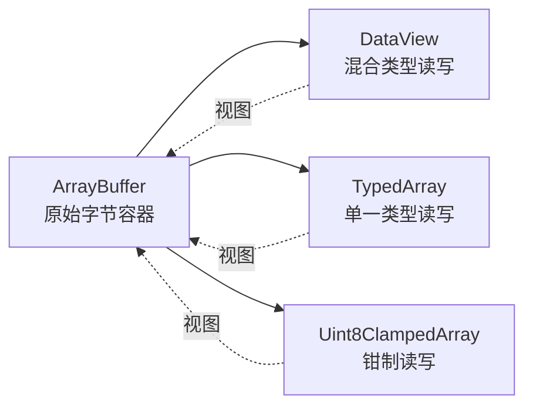
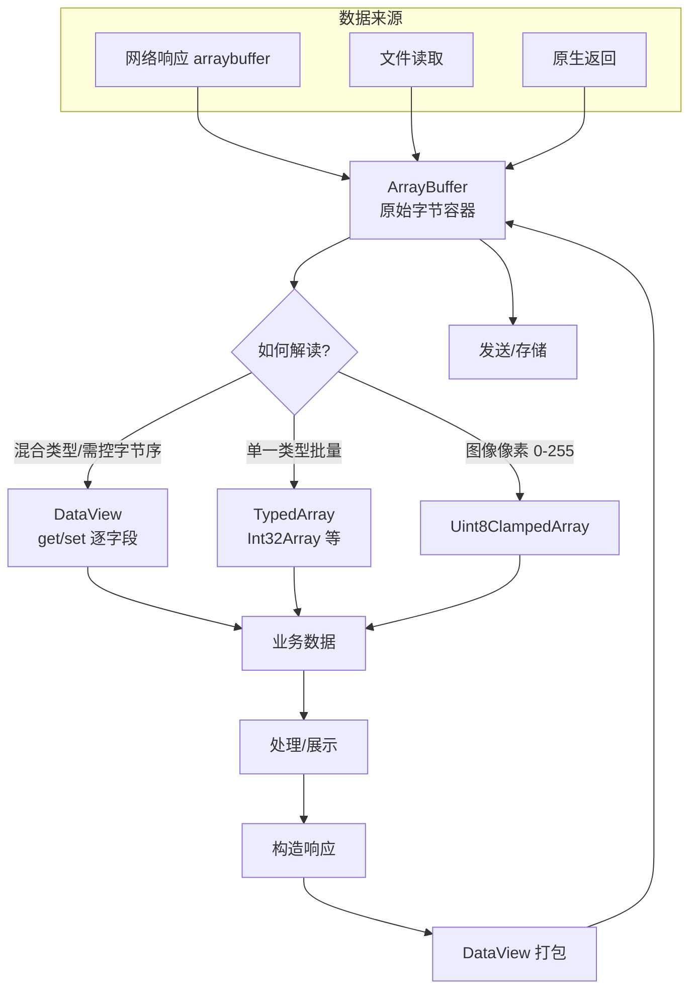

# DataView 与 ArrayBuffer 的区别、使用场景及实战案例

> 关联文档：[DataView 使用指南](./DataView使用指南.md) · [Uint8ClampedArray 使用指南](./Uint8ClampedArray使用指南.md)

首先要澄清一个关键认知：**ArrayBuffer 和 DataView 不是竞争关系，而是"容器"与"读取器"的互补关系**。ArrayBuffer 负责**存储**原始字节，DataView 负责**读写**这些字节。

---

## 一、本质区别

| 维度 | ArrayBuffer | DataView |
|------|-------------|----------|
| **角色** | 原始二进制数据**容器** | 数据的**读写视图** |
| **能否直接读写** | ❌ 不能，只能看 `byteLength` | ✅ 能，通过 `get/set` 方法 |
| **数据含义** | 无类型，纯字节序列 | 赋予字节具体类型（int/float…） |
| **字节序控制** | 无 | ✅ 可指定大端/小端 |
| **对齐约束** | 无 | 无（任意偏移） |
| **能否独立存在** | ✅ 可独立创建 | ❌ 必须依附于 ArrayBuffer |
| **典型操作** | `new ArrayBuffer(n)`、`slice()` | `getInt32()`、`setFloat64()` |

**关系图**：



> **类比**：ArrayBuffer 是一块**空白硬盘**，DataView / TypedArray 是**不同的文件系统**，用不同方式解读同一块硬盘上的数据。

---

## 二、为什么需要两者配合？

ArrayBuffer 本身**无法读取内容**：

```uts
let buf = new ArrayBuffer(8)
console.log(buf.byteLength)   // 8 —— 只能知道大小
// console.log(buf[0])        // ❌ 报错！ArrayBuffer 不支持索引访问
```

必须通过视图才能读写：

```uts
let buf = new ArrayBuffer(8)
let dv = new DataView(buf)    // 创建视图
dv.setInt32(0, 12345)         // ✅ 写入
console.log(dv.getInt32(0))   // ✅ 读取 → 12345
```

---

## 三、使用场景对比

| 场景 | ArrayBuffer | DataView | 说明 |
|------|:-----------:|:--------:|------|
| 接收网络/文件原始数据 | ✅ 主用 | — | `uni.request` 的 `responseType: 'arraybuffer'` |
| 解析二进制协议 | 提供数据 | ✅ 主用 | 混合类型 + 字节序控制 |
| 同类型数组批量运算 | 提供数据 | — | 用 TypedArray 更合适 |
| 图像像素处理 | 提供数据 | — | 用 Uint8ClampedArray |
| 与原生交互 | ✅ 主用 | 辅助 | `toByteBuffer()` / `toData()` |
| 数据切片/复制 | ✅ `slice()` | — | 生成新 buffer |
| 需要字节序转换 | — | ✅ 主用 | 网络大端 ↔ 本地小端 |

**核心结论**：

- **ArrayBuffer**：数据的"来源"和"载体"，负责传输、存储、切片
- **DataView**：数据的"解释器"，负责按结构解析、按字节序读写

---

## 四、实战案例

### 案例 1：解析网络二进制协议包 ⭐

**场景**：设备通过 TCP 发送定长协议帧，需解析出各字段。

协议定义：`magic(2字节,大端) + version(1字节) + temperature(2字节,小端) + timestamp(4字节,大端)`

```uts
// 1. 从网络接收原始数据（ArrayBuffer 作为载体）
uni.request({
  url: 'https://api.example.com/device/data',
  responseType: 'arraybuffer',   // 关键：按二进制接收
  success: (res) => {
    const buf = res.data as ArrayBuffer   // ← ArrayBuffer 承载原始字节

    // 2. 用 DataView 按协议结构解析
    const dv = new DataView(buf)
    const magic       = dv.getUint16(0, false)   // 大端魔数
    const version     = dv.getUint8(2)           // 版本号
    const temperature = dv.getInt16(3, true)     // 小端温度（可能为负）
    const timestamp   = dv.getUint32(5, false)   // 大端时间戳

    console.log(`魔数=${magic}, 版本=${version}, 温度=${temperature / 10}℃, 时间=${timestamp}`)
  }
})
```

> **分工**：ArrayBuffer 负责"接住"网络字节流，DataView 负责"翻译"成业务字段。

---

### 案例 2：解析 WAV 音频文件头

**场景**：读取音频文件的采样率、声道数、位深。

WAV 头部结构（小端）：`RIFF(4) + size(4) + WAVE(4) + fmt(4) + ... + sampleRate(4) + ... + channels(2) + ... + bitsPerSample(2)`

```uts
function parseWavHeader(buf: ArrayBuffer): UTSJSONObject {
  const dv = new DataView(buf)

  // 读取 4 字节 ASCII 标识（用 Uint8 逐字节转字符）
  const readTag = (offset: number): string => {
    let s = ''
    for (let i = 0; i < 4; i++) {
      s += String.fromCharCode(dv.getUint8(offset + i))
    }
    return s
  }

  const riff = readTag(0)                    // "RIFF"
  const wave = readTag(8)                    // "WAVE"
  const sampleRate    = dv.getUint32(24, true)  // 采样率（小端）
  const channels      = dv.getUint16(22, true)  // 声道数
  const bitsPerSample = dv.getUint16(34, true)  // 位深

  return {
    format: riff + '/' + wave,
    sampleRate: sampleRate,
    channels: channels,
    bitsPerSample: bitsPerSample
  } as UTSJSONObject
}
```

> **分工**：ArrayBuffer 是文件字节，DataView 按 WAV 规范逐字段解析。

---

### 案例 3：构造二进制数据包发送

**场景**：向设备发送控制指令，需按协议打包。

```uts
function buildCommandPacket(cmdId: number, value: number): ArrayBuffer {
  // 1. 创建固定大小的 ArrayBuffer（容器）
  const buf = new ArrayBuffer(8)

  // 2. 用 DataView 按协议写入各字段
  const dv = new DataView(buf)
  dv.setUint8(0, 0xAA)              // 帧头
  dv.setUint8(1, cmdId)             // 命令 ID
  dv.setInt32(2, value, false)      // 参数（大端）
  dv.setUint16(6, 0x55AA, false)    // 帧尾校验

  return buf   // 返回 ArrayBuffer 用于发送
}

// 发送
const packet = buildCommandPacket(0x01, 1000)
uni.request({
  url: 'https://api.example.com/device/control',
  method: 'POST',
  data: packet,          // 直接发送 ArrayBuffer
  header: { 'Content-Type': 'application/octet-stream' }
})
```

> **分工**：DataView 负责"组装"字节，ArrayBuffer 负责"承载"并发送。

---

### 案例 4：字节序转换（网络 ↔ 本地）

**场景**：网络协议用大端，本地计算用小端，需转换。

```uts
function swapEndian16(value: number): number {
  const buf = new ArrayBuffer(2)
  const dv = new DataView(buf)
  dv.setUint16(0, value, false)   // 按大端写入
  return dv.getUint16(0, true)    // 按小端读出 → 完成字节序翻转
}

console.log(swapEndian16(0x1234))  // 0x3412 = 13330
```

> **分工**：ArrayBuffer 提供 2 字节临时空间，DataView 用不同字节序读写实现翻转。

---

### 案例 5：ArrayBuffer 切片（数据分段）

**场景**：大文件分片上传，ArrayBuffer 的 `slice()` 直接切分。

```uts
const fullBuf = new ArrayBuffer(1024 * 1024)   // 1MB
const chunkSize = 256 * 1024                    // 256KB

for (let i = 0; i < 4; i++) {
  const chunk = fullBuf.slice(i * chunkSize, (i + 1) * chunkSize)  // ← ArrayBuffer 切片
  uploadChunk(chunk, i)
}
```

> 这里**不需要 DataView**，因为只是搬运字节，不解析内容。

---

### 案例 6：与原生交互（Android/iOS）

**场景**：把 UTS 中的二进制数据传给原生图像处理库。

```uts
const buf = new ArrayBuffer(1920 * 1080 * 4)   // RGBA 像素
const pixels = new Uint8ClampedArray(buf)      // 用钳制数组填充像素
// ... 填充像素数据 ...

// #ifdef APP-ANDROID
const byteBuffer = buf.toByteBuffer()   // 转 Android 原生 ByteBuffer
// #endif
// #ifdef APP-IOS
const data = buf.toData()               // 转 iOS 原生 Data
// #endif
```

> **分工**：ArrayBuffer 是跨层传递的载体，`toByteBuffer()`/`toData()` 完成平台转换。

---

## 五、三者协作全景图



---

## 六、选择速查表

| 你的需求 | 用什么 |
|---------|--------|
| 接收/存储原始二进制 | **ArrayBuffer** |
| 切片、复制、拼接字节 | **ArrayBuffer**（`slice`） |
| 解析混合类型结构体 | **ArrayBuffer + DataView** |
| 需要控制大端/小端 | **ArrayBuffer + DataView** |
| 同类型数值批量运算 | **ArrayBuffer + TypedArray** |
| 图像像素处理 | **ArrayBuffer + Uint8ClampedArray** |
| 传给原生 | **ArrayBuffer**（`toByteBuffer`/`toData`） |

---

## 七、关键要点总结

| 要点 | 说明 |
|------|------|
| **互补而非对立** | ArrayBuffer 是容器，DataView 是读取器，必须配合使用 |
| **ArrayBuffer 不可直接读写** | 只能通过视图（DataView/TypedArray）访问 |
| **DataView 必须依附 buffer** | 不能独立创建，构造时需传入 ArrayBuffer |
| **DataView 独有能力** | 混合类型读写 + 字节序控制 + 无对齐约束 |
| **典型组合** | 网络/文件 → ArrayBuffer → DataView 解析 → 业务对象 |
| **常见陷阱** | 字节序默认大端；越界抛 RangeError |

> **一句话记忆**：**ArrayBuffer 装数据，DataView 读数据；要解析结构复杂的二进制，就用 ArrayBuffer + DataView 组合。**
