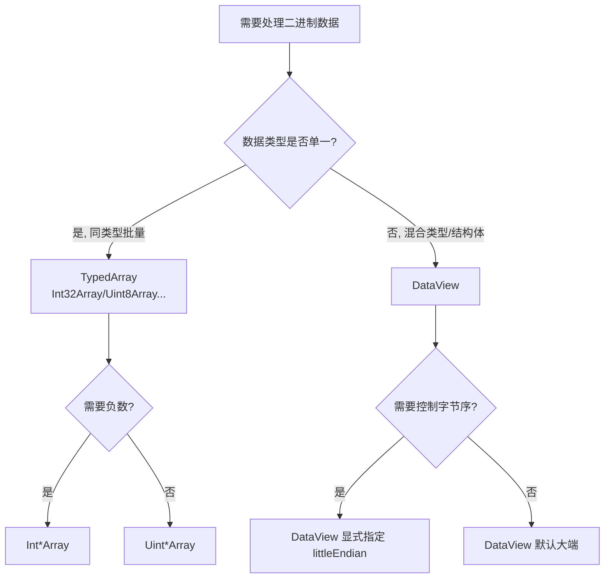

# uni-app x 中 DataView 使用指南

> 文档来源：<https://doc.dcloud.net.cn/uni-app-x/uts/buildin-object-api/dataview.html>

`DataView` 是一个**底层二进制数据读写视图**，它建立在 `ArrayBuffer` 之上，允许你以**任意字节偏移**、**任意数据类型**、**指定字节序**读写二进制数据。与 TypedArray 不同，它**没有对齐约束**，是解析二进制协议的最佳工具。

---

## 一、DataView vs TypedArray（核心区别）

| 特性 | TypedArray（如 Int32Array） | DataView |
|------|---------------------------|----------|
| 元素类型 | 固定单一类型 | **可混合读写多种类型** |
| 字节序 | 跟随平台（不可控） | **可显式指定大端/小端** |
| 对齐约束 | 有（偏移须为元素大小整数倍） | **无对齐约束，任意偏移** |
| 读写方式 | `arr[i]` 索引 | `getXxx(offset)` / `setXxx(offset, value)` |
| 适用场景 | 同类型数组运算 | **二进制协议解析、混合结构** |

> **一句话**：TypedArray 适合"同类型批量数据"，DataView 适合"结构复杂的二进制数据包"。

---

## 二、构造函数

```uts
new DataView(buffer: ArrayBufferLike, byteOffset?: number, byteLength?: number): DataView
```

| 参数 | 类型 | 必填 | 说明 |
|------|------|------|------|
| `buffer` | ArrayBufferLike | 是 | 底层 ArrayBuffer 实例 |
| `byteOffset` | number | 否 | 视图起始偏移量，**单位字节** |
| `byteLength` | number | 否 | 视图长度（字节） |

```uts
let buffer = new ArrayBuffer(16)
let view1 = new DataView(buffer)          // 覆盖整个 buffer
let view2 = new DataView(buffer, 4)       // 从第 4 字节到末尾
let view3 = new DataView(buffer, 4, 8)    // 从第 4 字节起，共 8 字节
```

---

## 三、实例属性（均只读，构造时固定）

| 属性 | 说明 |
|------|------|
| `buffer` | 引用的 `ArrayBuffer` 实例 |
| `byteLength` | 视图长度（字节） |
| `byteOffset` | 视图相对 buffer 起始的字节偏移量 |

---

## 四、读取方法（get）

| 方法 | 读取类型 | 字节数 | 取值范围 | 支持字节序参数 |
|------|---------|--------|---------|--------------|
| `getInt8(offset)` | 有符号 8 位 | 1 | −128 ~ 127 | ❌ |
| `getUint8(offset)` | 无符号 8 位 | 1 | 0 ~ 255 | ❌ |
| `getInt16(offset, le?)` | 有符号 16 位 | 2 | −32768 ~ 32767 | ✅ |
| `getUint16(offset, le?)` | 无符号 16 位 | 2 | 0 ~ 65535 | ✅ |
| `getInt32(offset, le?)` | 有符号 32 位 | 4 | −2³¹ ~ 2³¹−1 | ✅ |
| `getUint32(offset, le?)` | 无符号 32 位 | 4 | 0 ~ 2³²−1 | ✅ |
| `getFloat32(offset, le?)` | 单精度浮点 | 4 | IEEE 754 | ✅ |
| `getFloat64(offset, le?)` | 双精度浮点 | 8 | IEEE 754 | ✅ |

> **注意**：`littleEndian` 参数**默认 false（大端）**。8 位类型无字节序问题，故无此参数。

---

## 五、写入方法（set）

| 方法 | 写入类型 | 字节数 |
|------|---------|--------|
| `setInt8(offset, value)` | 有符号 8 位 | 1 |
| `setUint8(offset, value)` | 无符号 8 位 | 1 |
| `setInt16(offset, value, le?)` | 有符号 16 位 | 2 |
| `setUint16(offset, value, le?)` | 无符号 16 位 | 2 |
| `setInt32(offset, value, le?)` | 有符号 32 位 | 4 |
| `setUint32(offset, value, le?)` | 无符号 32 位 | 4 |
| `setFloat32(offset, value, le?)` | 单精度浮点 | 4 |
| `setFloat64(offset, value, le?)` | 双精度浮点 | 8 |

所有 `set` 方法返回 `void`。

---

## 六、字节序（Endianness）—— 关键概念

字节序决定多字节数值在内存中的排列顺序：

| 字节序 | 说明 | 典型平台/协议 |
|--------|------|--------------|
| **大端（Big-Endian）** | 高位字节在前 | 网络协议（TCP/IP）、Java、部分硬件 |
| **小端（Little-Endian）** | 低位字节在前 | x86/ARM、Windows、Android、iOS |

```uts
let buffer = new ArrayBuffer(4)
let view = new DataView(buffer)
view.setUint16(0, 0x1234, false)  // 大端：12 34
view.setUint16(0, 0x1234, true)   // 小端：34 12
```

> ⚠️ **默认是大端**（`littleEndian` 省略或为 false）。解析网络协议时通常用大端；解析本地文件/原生数据时常用小端。**字节序搞错会导致数值完全错误**，这是二进制解析最常见的 bug。

---

## 七、完整示例

```uts
// 1. 基础读写
let buffer = new ArrayBuffer(16)
let view = new DataView(buffer)

view.setInt8(0, 127)              // 最大有符号 8 位
console.log(view.getInt8(0))      // 127

view.setUint8(1, 255)             // 最大无符号 8 位
console.log(view.getUint8(1))     // 255

view.setInt16(2, 32767)           // 最大有符号 16 位
console.log(view.getInt16(2))     // 32767

view.setInt32(4, 2147483647)      // 最大有符号 32 位
console.log(view.getInt32(4))     // 2147483647

view.setFloat32(8, 3)
console.log(view.getFloat32(8))   // 3

view.setFloat64(8, Math.PI)
console.log(view.getFloat64(8))   // 3.141592653589793
```

```uts
// 2. 混合类型结构体（无对齐约束，任意偏移）
let buf = new ArrayBuffer(12)
let dv = new DataView(buf)
dv.setUint8(0, 0x01)              // 版本号
dv.setUint16(1, 1000, false)      // 长度（大端）
dv.setInt32(3, -12345, true)      // 温度（小端）
dv.setFloat32(7, 36.5, true)      // 浮点值（小端）
// 注意：偏移 1、3、7 都不是元素大小的整数倍，DataView 依然支持
```

---

## 八、典型使用场景

### 1. 二进制协议解析（最主要用途）⭐

解析 TCP/UDP 数据包、自定义通信协议、文件格式（PNG、WAV、MP4 头部等）：

```uts
// 解析一个简单的协议头：magic(2) + version(1) + length(4) + payload
let dv = new DataView(packetBuffer)
let magic   = dv.getUint16(0, false)   // 大端魔数
let version = dv.getUint8(2)
let length  = dv.getUint32(3, false)   // 大端长度
```

### 2. 网络字节序转换

网络协议统一使用**大端**，本地数据多为小端，DataView 可精确控制转换。

### 3. 文件格式解析

读取图片/音频/视频文件的头部字段（如 WAV 的采样率、位深）。

### 4. 与原生交互

配合 `toByteBuffer()`（Android）/ `toData()`（iOS）在原生层与 UTS 层之间传递结构化二进制数据。

### 5. 加密 / 哈希 / 编解码

处理 AES、CRC、Base64 等算法中的字节级操作。

### 6. 传感器 / 硬件数据

解析蓝牙、串口等设备返回的定长二进制帧。

---

## 九、选择决策



| 场景 | 推荐 |
|------|------|
| 同类型数组批量运算 | TypedArray |
| 二进制协议/文件格式解析 | **DataView** |
| 需要显式控制字节序 | **DataView** |
| 混合类型结构体 | **DataView** |
| 图像像素处理 | Uint8ClampedArray |

---

## 十、兼容性

- **uni-app x**：全平台（Android / iOS / Web / 鸿蒙）支持，起始版本约 **4.11+**
- **uni-app**：支持（4.51+）
- `toByteBuffer()` 仅 Android，`toData()` 仅 iOS，跨平台需条件编译

---

## 十一、注意事项

1. **默认大端**：`littleEndian` 省略时为 `false`（大端），与直觉可能相反，务必显式指定。
2. **越界会抛异常**：读写超出 `byteLength` 范围会抛出 `RangeError`，需自行校验偏移。
3. **无对齐约束**：可从任意字节偏移读写，这是它相对 TypedArray 的最大优势。
4. **属性只读**：`buffer`、`byteLength`、`byteOffset` 构造后不可变。
5. **性能**：逐字段 `get/set` 比 TypedArray 批量访问略慢，纯同类型大数据优先 TypedArray。

---

## 总结

| 维度 | 结论 |
|------|------|
| **本质** | ArrayBuffer 上的二进制读写视图，支持混合类型 + 字节序控制 |
| **核心优势** | 无对齐约束、可指定大端/小端、可混合读写多种类型 |
| **关键陷阱** | 默认大端；越界抛 RangeError；字节序错误导致数值错乱 |
| **最佳场景** | 二进制协议解析、文件格式解析、网络字节序转换、原生数据交互 |
| **对比选择** | 同类型批量用 TypedArray；混合结构/需控字节序用 DataView |
