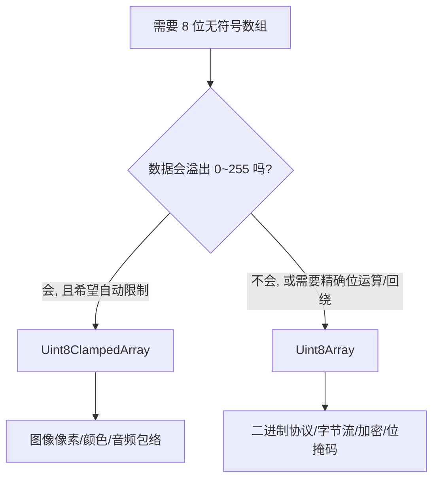

# uni-app x 中 Uint8ClampedArray 使用指南

> 文档来源：<https://doc.dcloud.net.cn/uni-app-x/uts/buildin-object-api/uint8clampedarray.html>

`Uint8ClampedArray` 是 **8 位无符号整数类型化数组**，与 `Uint8Array` 几乎完全相同，**唯一本质区别是赋值时的"钳制（clamp）"行为**——这正是它存在的意义。

---

## 一、核心特性：钳制（Clamping）

这是它区别于 `Uint8Array` 的关键。写入超出 `0~255` 范围的值时：

| 行为 | Uint8Array | Uint8ClampedArray |
|------|-----------|-------------------|
| 写入 300 | **44**（回绕，300−256） | **255**（钳制到上限） |
| 写入 −10 | **246**（回绕，−10+256） | **0**（钳制到下限） |
| 写入 255.6 | **255**（截断） | **255**（四舍五入后钳制） |
| 写入 254.5 | **254**（截断） | **255**（四舍五入） |
| 写入 NaN | 0 | 0 |
| 写入 128.5 | 128 | **128**（银行家舍入规则） |

**规则总结**：

1. **先四舍五入**到最近整数（`.5` 采用"银行家舍入"——舍入到最近的偶数）
2. **再钳制**到 `[0, 255]` 区间，超出即取边界值
3. **绝不回绕**，绝不产生意外的大跳变

```uts
let c = new Uint8ClampedArray(1)
c[0] = 300;   console.log(c[0])  // 255
c[0] = -10;   console.log(c[0])  // 0
c[0] = 128.5; console.log(c[0])  // 128（银行家舍入到偶数）
c[0] = 129.5; console.log(c[0])  // 130
```

---

## 二、基本属性

| 属性 | 值 / 说明 |
|------|-----------|
| `BYTES_PER_ELEMENT` | **1**（每元素 1 字节） |
| 取值范围 | **0 ~ 255**（无符号） |
| `buffer` | 引用的 `ArrayBuffer` 实例 |
| `byteLength` | 字节长度（= 元素个数） |
| `byteOffset` | 字节偏移量 |
| `length` | 元素个数 |

---

## 三、构造函数（三种重载）

```uts
// 1. 按长度创建（用 0 填充）
let a = new Uint8ClampedArray(4)          // [0,0,0,0]

// 2. 从数组 / 可迭代对象创建（会做钳制转换）
let b = new Uint8ClampedArray([1, 2, 3])
let c = new Uint8ClampedArray([300, -5, 128.5])  // [255, 0, 128]

// 3. 从 ArrayBuffer 创建视图（byteOffset 单位是字节）
let buf = new ArrayBuffer(8)
let d = new Uint8ClampedArray(buf, 0, 8)  // 8 个元素
```

**静态方法**：

```uts
let x = Uint8ClampedArray.of(1, 2, 3)   // [1,2,3]
let y = Uint8ClampedArray.from([1, 2, 3], (v: number, _: number): number => v * 2)  // [2,4,6]
```

---

## 四、实例方法（与其它 TypedArray 一致）

- **遍历 / 查询**：`forEach`、`every`、`some`、`find`、`findIndex`、`indexOf`、`join`、`toString`、`values`、`entries`、`keys`
- **变换 / 生成新数组**：`map`、`filter`、`slice`（副本）、`subarray`（共享内存视图）
- **原地修改**：`fill`、`copyWithin`、`reverse`、`sort`、`set`
- **ArrayBufferLike 方法**：`slice`、`toByteBuffer()`（仅 Android）、`toData()`（仅 iOS）

```uts
let arr = new Uint8ClampedArray([3, 1, 2])
arr.sort()                       // [1,2,3]
arr.fill(0, 1)                   // [1,0,0]
let sub  = arr.subarray(0, 2)    // 视图，共享内存
let copy = arr.slice(0, 2)       // 副本，独立内存
```

---

## 五、典型使用场景

### 1. 图像像素处理（最主要用途）⭐

Canvas 的 `ImageData.data` 就是 `Uint8ClampedArray`。做亮度、对比度、滤镜等运算时，结果可能溢出 `0~255`，钳制行为能**自动防止颜色失真**：

```uts
// 亮度调整：+50
let data = new Uint8ClampedArray([10, 200, 250])
for (let i = 0; i < data.length; i++) {
  data[i] = data[i] + 50   // 60, 250, 255（自动钳制，不会回绕成 44）
}
```

若用 `Uint8Array`，`250+50=300` 会回绕成 `44`，导致亮部突然变暗——这是图像处理中的经典 bug。

### 2. 颜色通道运算

RGBA 各通道天然是 `0~255`，做混合、叠加、透明度计算时钳制最安全：

```uts
// 两图叠加（alpha 混合）
let result = new Uint8ClampedArray(4)
result[0] = 0.5 * 200 + 0.5 * 100   // 150
result[1] = 0.5 * 250 + 0.5 * 200   // 225
```

### 3. 音频波形 / 音量包络

8 位无符号音频采样，音量增益后需限制在 `0~255` 防止爆音。

### 4. 传感器 / 归一化数据

任何"物理量映射到 0~255"的场景（如灰度图、热力图、强度图），钳制可保证数据合法。

### 5. 与原生图像 API 交互

配合 `toByteBuffer()`（Android）/ `toData()`（iOS）把像素数据传给原生图像处理库。

---

## 六、Uint8Array vs Uint8ClampedArray 选择



| 场景 | 推荐类型 |
|------|---------|
| 图像像素、颜色通道 | **Uint8ClampedArray** |
| 音频包络、归一化数据 | **Uint8ClampedArray** |
| 二进制协议解析、字节流 | Uint8Array |
| 位运算、哈希、加密 | Uint8Array |
| 需要回绕语义 | Uint8Array |

> **一句话**：需要"安全钳制、绝不回绕"用 `Uint8ClampedArray`；需要"精确字节/位操作"用 `Uint8Array`。

---

## 七、兼容性

- **uni-app x**：全平台（Android / iOS / Web / 鸿蒙）支持，起始版本约 **4.11+**
- **uni-app**：支持（4.51+）
- `toByteBuffer()` 仅 Android，`toData()` 仅 iOS，跨平台需条件编译

---

## 八、注意事项

1. **钳制 ≠ 校验**：它静默修正数据，不会报错。若需感知越界，应自行判断。
2. **银行家舍入**：`.5` 舍入到最近偶数（`128.5→128`，`129.5→130`），与直觉的"四舍五入"略有差异。
3. **`subarray` 共享内存**：修改视图会影响原数组；需独立副本用 `slice`。
4. **性能**：钳制比 `Uint8Array` 略慢（多一次舍入+边界判断），纯字节流场景优先 `Uint8Array`。

---

## 总结

| 维度 | 结论 |
|------|------|
| **本质** | 8 位无符号整数数组，范围 `0~255`，每元素 1 字节 |
| **核心差异** | 赋值时**先四舍五入、再钳制**，绝不回绕 |
| **API** | 与 `Uint8Array` 完全一致，可无缝替换 |
| **最佳场景** | 图像像素、颜色通道、音频包络等"0~255 物理量"处理 |
| **对比选择** | 要安全钳制选它；要精确字节/位操作选 `Uint8Array` |
